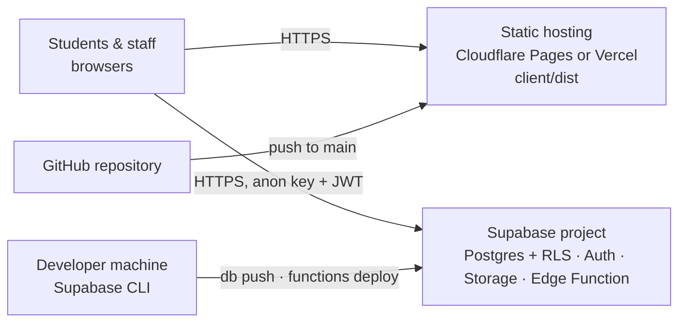

# Deployment Guide

End-to-end instructions for deploying, operating and updating the application. For what the app does, see [README.md](README.md). For internals (schema, permissions, code), see [DEVELOPER_GUIDE.md](DEVELOPER_GUIDE.md).

## Table of contents
1. [Deployment architecture](#deployment-architecture)
2. [Supported hosting platforms](#supported-hosting-platforms)
3. [Prerequisites and accounts](#prerequisites-and-accounts)
4. [GitHub repository setup](#github-repository-setup)
5. [Supabase project setup](#supabase-project-setup)
6. [Database schema and migration deployment](#database-schema-and-migration-deployment)
7. [Edge Function deployment](#edge-function-deployment)
8. [Authentication configuration](#authentication-configuration)
9. [Initial admin account creation](#initial-admin-account-creation)
10. [Environment variables](#environment-variables)
11. [Frontend build and hosting](#frontend-build-and-hosting)
12. [Custom domain, DNS and HTTPS](#custom-domain-dns-and-https)
13. [Security and RLS verification](#security-and-rls-verification)
14. [Post-deployment smoke tests](#post-deployment-smoke-tests)
15. [Updating and redeploying](#updating-and-redeploying)
16. [Rollback procedure](#rollback-procedure)
17. [Database backup and recovery](#database-backup-and-recovery)
18. [Monitoring and troubleshooting](#monitoring-and-troubleshooting)
19. [Free-tier limits and possible costs](#free-tier-limits-and-possible-costs)

---

## Deployment architecture



- **The website is static.** Vite builds `client/` to `client/dist/`. There is no application server to run.
- **Supabase** provides the database, row-level security, authentication, image storage, and the `admin-users` Edge Function.
- **The database schema** is deployed from `supabase/migrations/` with the Supabase CLI. It is not deployed by the hosting platform.

## Supported hosting platforms

| Platform | Status | Config in repo | Notes |
|---|---|---|---|
| **Cloudflare Pages** | Recommended | `client/public/_headers` (headers); SPA fallback is automatic | The free plan allows commercial use and has generous static bandwidth |
| **Vercel** | Supported | `client/vercel.json` (rewrites + headers) | The **Hobby (free) plan is for personal, non-commercial use only**. An institute website is normally commercial, so budget for Vercel Pro or use Cloudflare Pages. |
| Other static hosts (Netlify, GitHub Pages…) | Not configured | - | Would need their own SPA-fallback and header configuration. Not covered here. |

## Prerequisites and accounts
- Accounts: **GitHub**, **Supabase**, and **Cloudflare** (or Vercel).
- Optional: an SMTP provider for password-reset emails ([§8](#authentication-configuration)) and a domain name.
- Computer: **Node.js 20+** and **Git**. Docker is only needed for local development.
- In the project folder: `npm install` (installs the Supabase CLI locally as `npx supabase`).

## GitHub repository setup
```bash
git init
git add .
git commit -m "Initial commit"
git branch -M main
git remote add origin https://github.com/<you>/<repo>.git
git push -u origin main
```
- Use a **private** repository. Run `git status` before every commit. `.env`, `.env.local`, `supabase/.temp/` and test output are git-ignored, and must stay out of the repository.

## Supabase project setup
1. In the Supabase Dashboard, click **New project**. Choose an organisation, a name, a **strong database password** (save it in a password manager) and the region nearest your users (for example `ap-south-1`, Mumbai).
2. When the project is ready, open **Project Settings → API / API Keys** and record:
   - **Project URL**: `https://<ref>.supabase.co`. `<ref>` is the project reference.
   - **anon / publishable key**: public; it goes into the website.
   - **service_role / secret key**: **secret**. Only use it on your own machine for the admin bootstrap. Never put it in hosting variables, Git or chat.

## Database schema and migration deployment
```bash
npx supabase login                         # opens a browser once
npx supabase link --project-ref <ref>      # prompts for the database password
npx supabase db push                       # applies supabase/migrations/* in order
```
- This creates every table, function, trigger, view, RLS policy, grant, and the `public-assets` storage bucket.
- `supabase/seed.sql` (sample data) is **not** applied. Production starts empty apart from the default `institute_settings` row.
- To check which migrations are applied, run `npx supabase migration list`.

## Edge Function deployment
```bash
npx supabase functions deploy admin-users
npx supabase secrets set ALLOWED_ORIGINS=https://<your-site>.pages.dev,https://www.<your-domain>
```
- Supabase injects `SUPABASE_URL`, `SUPABASE_ANON_KEY` and `SUPABASE_SERVICE_ROLE_KEY` into the function, so you don't set them yourself.
- `ALLOWED_ORIGINS` limits browser CORS to your site. If it's unset, the default is `*`.
- If your project shows only the newer key names in the dashboard, check under **Edge Functions → Secrets** that the default `SUPABASE_*` secrets are listed. The function reads exactly those three names.

## Authentication configuration
Configure these in the Supabase Dashboard. `supabase/config.toml` only affects the local stack.

| Setting (Dashboard path) | Value |
|---|---|
| Authentication → Sign In / Providers → **Allow new users to sign up** | **Off.** Staff are created by a Super Admin. |
| Email provider | **Enabled.** Staff log in with email + password. |
| Password requirements | Minimum length **8**, letters and digits |
| Secure password change | On |
| Authentication → URL Configuration → **Site URL** | `https://<your-site>` (final production URL) |
| **Redirect URLs** | `https://<your-site>/admin/reset-password` (add one per domain, including preview domains you test on) |
| Authentication → Emails → **SMTP Settings** | Strongly recommended: a custom SMTP provider (for example Resend or Brevo; check their current free allowances). The built-in sender is heavily rate-limited and intended for testing only. |
| Attack Protection → CAPTCHA (optional) | Cloudflare Turnstile. Applies to Supabase Auth endpoints, not to the public registration form. |

## Initial admin account creation
Run this on a trusted machine with the **service_role** key.

**macOS / Linux**
```bash
SUPABASE_URL=https://<ref>.supabase.co \
SUPABASE_SERVICE_ROLE_KEY=<service_role key> \
SUPER_ADMIN_EMAIL=owner@yourinstitute.in \
SUPER_ADMIN_NAME="Institute Owner" \
SUPER_ADMIN_PASSWORD='<strong password: 8+ chars, letters and digits>' \
node scripts/create-super-admin.mjs
```

**Windows PowerShell**
```powershell
$env:SUPABASE_URL="https://<ref>.supabase.co"; $env:SUPABASE_SERVICE_ROLE_KEY="<service_role key>"
$env:SUPER_ADMIN_EMAIL="owner@yourinstitute.in"; $env:SUPER_ADMIN_NAME="Institute Owner"; $env:SUPER_ADMIN_PASSWORD="<strong password>"
node scripts/create-super-admin.mjs
Remove-Item Env:SUPABASE_SERVICE_ROLE_KEY, Env:SUPER_ADMIN_PASSWORD
```

The script is idempotent: if the email already exists in Auth, it only grants Super Admin.

**Alternative without the script:**
1. In **Authentication → Users → Add user**, create the user with auto-confirm on.
2. In the **SQL Editor**, run:
   ```sql
   insert into public.admin_users (id, email, full_name)
   select id, email, 'Institute Owner' from auth.users where email = 'owner@yourinstitute.in';
   insert into public.user_roles (user_id, role)
   select id, 'super_admin' from auth.users where email = 'owner@yourinstitute.in';
   ```

Add all other staff from **Admin → Users & Roles**.

## Environment variables

| Variable | Set in | Value | Secret? |
|---|---|---|---|
| `VITE_SUPABASE_URL` | Hosting project (Production, and Preview if used) | `https://<ref>.supabase.co` | No (bundled into JS) |
| `VITE_SUPABASE_ANON_KEY` | Hosting project | anon / publishable key | No (protected by RLS) |
| `NODE_VERSION` | Cloudflare Pages | `20` (or newer LTS) | No |
| `ALLOWED_ORIGINS` | Supabase function secrets | your site origins | No |
| `SUPABASE_SERVICE_ROLE_KEY` | **Only** your shell when running the bootstrap script | service key | **Yes. Never in hosting.** |

`VITE_*` variables are read at **build time**, so after changing them you must redeploy. The full variable reference is in [DEVELOPER_GUIDE.md §10](DEVELOPER_GUIDE.md#10-environment-and-configuration).

## Frontend build and hosting

Build facts (both platforms):

| Setting | Value |
|---|---|
| Root directory | `client` |
| Install / build | `npm install` / `npm run build` (runs `tsc --noEmit && vite build`) |
| Output | `dist` |
| SPA routing | All paths such as `/admin/students/…` must serve `index.html` |

### Option A: Cloudflare Pages (recommended)
1. Cloudflare Dashboard → **Workers & Pages → Create → Pages → Connect to Git**, then authorise GitHub and pick the repository.
2. Production branch: `main`. Framework preset: **None** (or Vite). **Root directory:** `client`. **Build command:** `npm run build`. **Build output directory:** `dist`.
3. **Environment variables** (Production, and Preview if you use previews): `VITE_SUPABASE_URL`, `VITE_SUPABASE_ANON_KEY`, `NODE_VERSION=20`.
4. **Save and Deploy.** Your site is live at `https://<project>.pages.dev`.
5. Security headers come from `client/public/_headers`, which is copied into `dist`. With no `404.html`, Cloudflare Pages serves `index.html` for unknown paths, so client-side routes work.

### Option B: Vercel
1. Vercel → **Add New → Project**, then import the GitHub repository.
2. **Root Directory:** `client`. The framework is detected as Vite. `client/vercel.json` sets the build command, the `dist` output, SPA rewrites and the security headers.
3. Add `VITE_SUPABASE_URL` and `VITE_SUPABASE_ANON_KEY` (Production, and Preview if used), then **Deploy**.
4. Check the plan: Hobby is non-commercial only (see [Supported hosting platforms](#supported-hosting-platforms)).

> **Content-Security-Policy.** Both header files allow API and image calls only to `https://*.supabase.co`. If you use a Supabase **custom domain**, add it to `connect-src` and `img-src` in **both** `client/public/_headers` and `client/vercel.json`, or the site will fail to load data.

## Custom domain, DNS and HTTPS
1. **Cloudflare Pages:** project → **Custom domains → Set up a domain**. If the domain's DNS is on Cloudflare, records are created automatically. Otherwise add the `CNAME` shown (for example `www → <project>.pages.dev`).
   **Vercel:** project → **Settings → Domains → Add**, then create the `A`/`CNAME` records Vercel shows.
2. **HTTPS:** both platforms issue and renew TLS certificates automatically. HSTS is already sent by the header files. Only enable `preload` if you understand the implications.
3. **After the domain is live, update:**
   - Supabase **Site URL** and **Redirect URLs** (`https://<domain>/admin/reset-password`)
   - `ALLOWED_ORIGINS` (run `supabase secrets set` again)
4. **Optional:** a Supabase custom domain for the API is a paid add-on. If you use one, update `VITE_SUPABASE_URL` and the CSP.

## Security and RLS verification
Run these after the first deploy and after every schema change.
1. **Supabase Dashboard → Advisors → Security Advisor:** expect no "RLS disabled" or "exposed table" errors.
2. **Anonymous access is denied.** Each command should return an HTTP 401 or 403 with a `permission denied` body:
   ```bash
   curl -s "https://<ref>.supabase.co/rest/v1/students?select=id" -H "apikey: <anon key>"
   curl -s "https://<ref>.supabase.co/rest/v1/fee_payments?select=id" -H "apikey: <anon key>"
   curl -s -X POST "https://<ref>.supabase.co/rest/v1/rpc/dashboard_summary" -H "apikey: <anon key>" -H "Content-Type: application/json" -d "{}"
   ```
3. **The public catalogue works anonymously:**
   ```bash
   curl -s -X POST "https://<ref>.supabase.co/rest/v1/rpc/get_public_catalog" -H "apikey: <anon key>" -H "Content-Type: application/json" -d "{}"
   ```
4. **Sign-up is disabled:** the Dashboard shows sign-ups off. A `POST /auth/v1/signup` with the anon key returns an error.
5. **The service key is not in the bundle.** Search the deployed JS for `service_role` or `sb_secret_`; there should be no matches.
6. **The automated security suite passes locally:** `npm run test:db`. See [DEVELOPER_GUIDE.md §13](DEVELOPER_GUIDE.md#13-testing-and-troubleshooting).

## Post-deployment smoke tests
- [ ] The homepage loads over HTTPS; there are no CSP errors in the browser console.
- [ ] Sign in at `/admin/login` as the Super Admin.
- [ ] **Settings:** institute name, logo, contact details, privacy policy, receipt footer and signatory. Reload the homepage and confirm they appear.
- [ ] **Courses:** create a category and a course with fees, add a batch, set the status to *Published*, and confirm it appears on the website.
- [ ] Submit a registration from the website (use your own email) and confirm the registration number is shown.
- [ ] In the admin portal, find it, change its status to *Approved*, and record a small payment. The receipt opens and prints.
- [ ] As Super Admin, **void** that test payment and confirm the balance is restored and the receipt shows VOID.
- [ ] **Forgot password:** the email arrives (needs SMTP) and the link opens `/admin/reset-password`.
- [ ] Create an Accounts Staff user and confirm they cannot see Users & Roles, Courses or Audit Log.
- [ ] Check the Reports, Dashboard and CSV exports.
- [ ] On a phone: the menu, catalogue and form work.

Test records stay in the database (payments are void, not deleted). That's intentional for auditability. Set test enrollments to *Withdrawn*.

## Updating and redeploying
- **Frontend:** push to `main`, and the hosting platform builds and deploys automatically. Pull requests or other branches get preview deployments if enabled. Previews use the same Supabase project unless you configure separate variables.
- **Database:**
  1. Create a **new** migration (never edit an applied one): `npx supabase migration new <name>`.
  2. Test locally: `npm run sb:reset && npm test && npm run test:e2e`.
  3. Back up production ([below](#database-backup-and-recovery)).
  4. Deploy: `npx supabase db push`.
  5. Deploy any frontend changes that depend on it **after** the migration. Make migrations backwards-compatible: add columns or functions first, remove old ones in a later release.
- **Edge Function:** `npx supabase functions deploy admin-users`.
- **Environment variables:** change them in the hosting dashboard, then redeploy.

## Rollback procedure
| What | How |
|---|---|
| Frontend | **Cloudflare Pages:** Deployments → choose a previous successful deployment → *Rollback*. **Vercel:** Deployments → previous deployment → *Promote to Production*. Or `git revert` and push. |
| Edge Function | Check out the previous commit and run `npx supabase functions deploy admin-users`. |
| Database | Migrations are forward-only; there are no automatic down-migrations. Write a new migration that reverses the change, test it locally, then `db push`. If data was damaged, restore from backup ([below](#database-backup-and-recovery)). Restoring replaces data entered since the backup, so record what is lost. |

## Database backup and recovery
On the **free plan** there is no point-in-time recovery. Do not rely on the platform for backups.

**Take a backup** (requires the project to be linked):
```bash
npx supabase db dump -f schema-$(date +%F).sql                        # schema (roles excluded)
npx supabase db dump --data-only -f data-$(date +%F).sql             # data
```
PowerShell: replace `$(date +%F)` with `$(Get-Date -Format yyyy-MM-dd)`.

- Store backups encrypted and off-site. They contain student personal data.
- Suggested frequency: daily during admissions season, weekly otherwise. Also export CSVs of students and payments from the admin portal.
- **Storage files** (course images, logo) are not in the database dump. Keep the originals, or download them from Storage.

**Restore into a new or empty project:**
1. Link to the new project.
2. Apply the schema with `npx supabase db push` (migrations).
3. Load the data with `psql "<connection string>" -f data-YYYY-MM-DD.sql` (connection string from Project Settings → Database).
4. Re-upload the Storage files. Check whether your data dump contains `auth.users` rows: open the file and search for `auth.users`. If it doesn't, recreate staff accounts in Users & Roles; their `admin_users` rows must reference the new auth user ids. Then run the smoke tests.

Practise a restore once on a spare project before you need it.

## Monitoring and troubleshooting
- **Supabase Dashboard:**
  - **Logs:** API, Auth, Postgres and Edge Functions.
  - **Reports / Usage:** database size, egress, monthly active users.
  - **Advisors:** security and performance.
- **Hosting dashboards:** build logs and deployment history.
- **Uptime:** a free monitor (for example UptimeRobot) checking the homepage also stops a free Supabase project going idle.
- **Audit trail:** Admin → Audit Log shows who changed what.

| Symptom | Likely cause → fix |
|---|---|
| Site shows "Configuration required" | `VITE_*` variables missing at build time → set them and redeploy |
| Data doesn't load; console shows a CSP violation | Supabase custom domain not in the CSP → update the header files |
| `/admin/...` returns 404 on refresh | SPA fallback missing → check the root directory is `client` and that `vercel.json` / `_headers` were deployed |
| Login: "does not have access" | No `admin_users` row or no roles → [Initial admin account creation](#initial-admin-account-creation) |
| Reset email never arrives | SMTP not configured, or the redirect URL isn't allowed → configure both |
| Reset link opens "Link expired" | Redirect URL mismatch or the link was already used → add the exact URL and request a new link |
| Users & Roles actions fail (403/CORS) | Edge Function not deployed, or `ALLOWED_ORIGINS` missing your domain |
| `permission denied` for staff | Missing role or permission → check Users & Roles. See the permission matrix in [DEVELOPER_GUIDE.md §7](DEVELOPER_GUIDE.md#7-authentication-and-authorization). |
| Site suddenly fails after a quiet week | Free Supabase project paused → Dashboard → *Restore project* |
| `db push` refuses to apply | An applied migration was edited, or the remote history differs → `npx supabase migration list`; never edit applied files |

## Free-tier limits and possible costs
Quotas change. **Check each provider's pricing page before launch.** Figures below are indicative only.

| Provider | Free tier (indicative) | When you may need to pay |
|---|---|---|
| **Supabase Free** | About 500 MB database, 1 GB file storage, limited egress, ~50,000 monthly active users, a limited number of free projects. **Projects pause after about a week without activity.** No point-in-time recovery or automated backup restore. | Database or storage growth, high traffic, needing no pausing, daily backups or PITR, custom domain, or more projects (Pro plan or add-ons) |
| **Cloudflare Pages Free** | Unlimited static requests and bandwidth; a monthly build quota | Many builds per month, or advanced features (Workers paid plan) |
| **Vercel Hobby** | Personal, **non-commercial** use with usage limits | Commercial use requires **Pro** |
| **SMTP provider** | Free monthly email allowance (varies) | Higher email volume |
| **Domain name** | Not free | Annual registration fee |

The application uses no paid APIs and does not process online payments. Hosting can stay free for a small institute, but **this is not guaranteed** under higher usage, stricter uptime needs, or provider policy changes. Review usage in each dashboard monthly.
