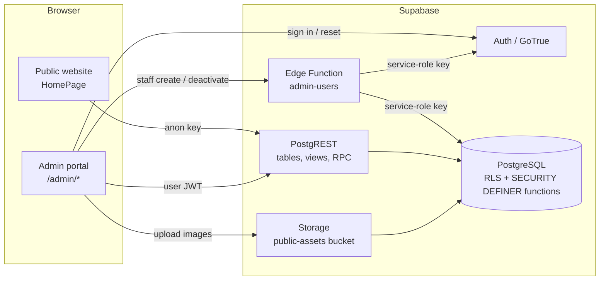
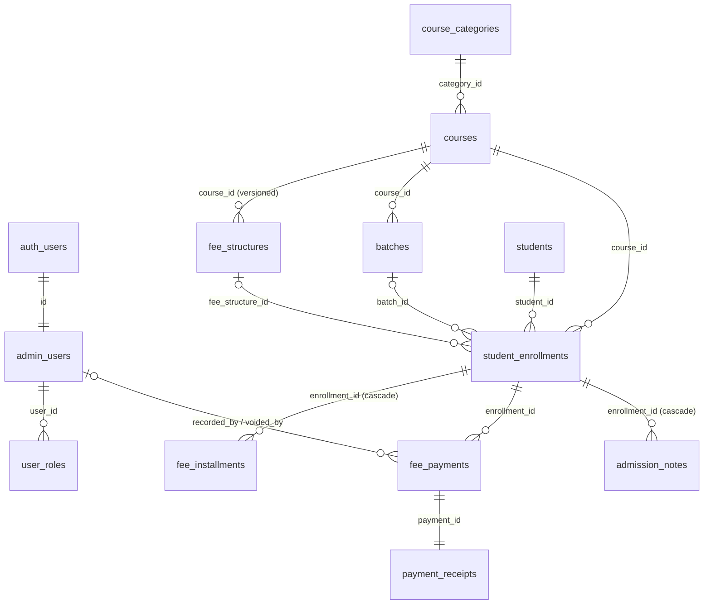

# Developer Guide

The complete technical reference for maintaining and extending the Education Institute Management & Student Enrollment Portal. For a quick overview, read [README.md](README.md). For hosting, read [DEPLOYMENT_GUIDE.md](DEPLOYMENT_GUIDE.md).

## Table of contents
1. [Introduction](#1-introduction)
2. [Technology stack](#2-technology-stack)
3. [Architecture](#3-architecture)
4. [Project folder structure](#4-project-folder-structure)
5. [Application modules](#5-application-modules)
6. [Database](#6-database)
7. [Authentication and authorization](#7-authentication-and-authorization)
8. [Student registration workflow](#8-student-registration-workflow)
9. [Financial management](#9-financial-management)
10. [Environment and configuration](#10-environment-and-configuration)
11. [API and service layer](#11-api-and-service-layer)
12. [Development workflow](#12-development-workflow)
13. [Testing and troubleshooting](#13-testing-and-troubleshooting)
14. [Security and operational considerations](#14-security-and-operational-considerations)
15. [Extending the application](#15-extending-the-application)
16. [Known limitations and future enhancements](#16-known-limitations-and-future-enhancements)
17. [Reference](#17-reference)

---

## 1. Introduction

### Purpose and scope
The application serves an education institute that sells courses to students:
- **Public website:** students browse courses and submit an admission application without creating an account.
- **Admin portal:** staff manage admissions, students, courses and batches, agreed fees and installments, payment collection, receipts and financial reports.

### Design principles
- **The database is the security boundary.** All authorisation is enforced by PostgreSQL Row Level Security (RLS) and permission checks inside database functions. The React app only hides what the database would refuse anyway.
- **No custom backend server.** The browser talks directly to Supabase with the public anon key. The only server-side code is one Supabase Edge Function for staff account management, which needs the service-role key.
- **Money is exact.** `NUMERIC(12,2)` in the database, all balance logic in SQL, integer paise for any client-side totals.
- **Financial history is immutable.** Payments are append-only (void, never edit or delete). Receipts are snapshots. Fee structures are versioned.
- **Free-tier friendly.** Static frontend, plus Supabase Free.

### Implementation status
Every module in [§5](#5-application-modules) is implemented and covered by automated tests ([§13](#13-testing-and-troubleshooting)). Gaps and planned work are listed in [§16](#16-known-limitations-and-future-enhancements).

**History.** The first version was a React SPA calling a custom Express 5 + Prisma 6 API, with a single admin role, JWTs in `sessionStorage`, Docker Postgres and Render hosting. It was replaced by the current Supabase architecture. That version lacked fine-grained roles, exact money arithmetic, receipts, installments, audit logging and image storage, and its free hosting had cold starts. The old code and its test data have been deleted.

### Supported workflows
1. Student browses courses → applies → receives a registration number.
2. Admissions staff review the application → move it through the 8-stage pipeline → assign a batch.
3. Fee administrators adjust the agreed fee or installment plan if needed.
4. Accounts staff record payments → a receipt is issued and printed.
5. A Super Admin issues refunds or voids mistaken entries.
6. Management reviews the dashboard and financial reports, and exports CSVs.
7. A Super Admin manages staff accounts, roles, institute settings, and reviews the audit log.

---

## 2. Technology stack

| Area | Technology (installed version) | Notes |
|---|---|---|
| Frontend framework | React 19.3, React DOM 19.3 | Function components and hooks |
| Routing | React Router 7.18 (`react-router` package, declarative `<Routes>`) | Admin pages are lazy-loaded |
| Language | TypeScript 5.9 (strict) | `client/tsconfig.json` |
| Build tool | Vite 7.3 + `@vitejs/plugin-react` 5.2 | Manual chunks: `vendor`, `supabase` |
| Backend / database | Supabase: PostgreSQL 17, PostgREST, GoTrue Auth, Storage, Edge Runtime (Deno 2) | Local stack via Supabase CLI 2.122 |
| Data access | `@supabase/supabase-js` 2.118 | Typed with generated `database.types.ts` |
| Authentication | Supabase Auth, email + password | Sessions persisted by supabase-js |
| UI / styling | Hand-written CSS design system (`client/src/styles.css`) and `lucide-react` 1.66 icons | No Tailwind, no component library |
| Charts | Custom CSS/SVG components (`components/ui/Charts.tsx`) | No chart library |
| Unit tests | Vitest 5 (client) | `client/src/lib/lib.test.ts` |
| Integration tests | Vitest 5 + supabase-js + `pg` 8 | `tests/` against local Supabase |
| E2E tests | Playwright 1.64 (Chromium, desktop + Pixel 7) | `e2e/` |
| Hosting | Cloudflare Pages or Vercel (static) + Supabase | See [DEPLOYMENT_GUIDE.md](DEPLOYMENT_GUIDE.md) |

Runtime dependencies of the website: `react`, `react-dom`, `react-router`, `@supabase/supabase-js`, `lucide-react`. Everything else is development tooling. Root `package.json` dev dependencies:

| Package | Used for |
|---|---|
| `supabase` | The CLI |
| `@supabase/supabase-js` | Scripts and tests |
| `pg` | Test housekeeping SQL |
| `vitest` | Database tests |
| `@playwright/test` | E2E tests |

---

## 3. Architecture



### Frontend ↔ database interaction
- **Reads** are mostly direct table or view selects via supabase-js (for example `from("enrollment_overview").select(...)`). RLS filters rows for the calling role.
- **Writes** to admissions and finance always go through RPCs (`supabase.rpc("record_payment", ...)`), because API roles have no direct write privilege on those tables.
- **Simple CRUD** (courses, batches, categories, student details, settings, notes, roles) uses direct inserts and updates guarded by RLS policies and column grants.

### Startup flow
1. `client/src/main.tsx` renders `<BrowserRouter> → <SettingsProvider> → <FeedbackProvider> → <AuthProvider> → <App/>`.
2. `SettingsProvider` (`hooks/useSettings.tsx`) loads `institute_settings` (public). It sets the page title and currency.
3. `AuthProvider` (`hooks/useAuth.tsx`) restores the Supabase session from storage, calls `rpc("my_profile")` to load roles and permissions, and subscribes to `onAuthStateChange`.
4. `App.tsx` shows a "Configuration required" screen if `VITE_SUPABASE_URL` or `VITE_SUPABASE_ANON_KEY` is missing. Otherwise it renders routes.

### Routes (`client/src/App.tsx`)

| Path | Page | Guard (UI only) |
|---|---|---|
| `/` | `pages/HomePage.tsx` | public |
| `/admin/login`, `/admin/forgot-password`, `/admin/reset-password` | `pages/admin/AuthPages.tsx` | public |
| `/admin` | `DashboardPage` inside `AdminLayout` | any active staff |
| `/admin/students`, `/admin/students/:id` | `StudentsPage`, `StudentProfilePage` | `students.read` |
| `/admin/payments` | `PaymentsPage` | `fees.read` |
| `/admin/receipts/:id` | `ReceiptPage` | `fees.read` |
| `/admin/reports` | `ReportsPage` | `reports.view` |
| `/admin/courses` | `CoursesPage` | `courses.manage` |
| `/admin/users` | `UsersPage` | `users.manage` |
| `/admin/audit` | `AuditLogPage` | `audit.read` |
| `/admin/settings` | `SettingsPage` | any staff (institute profile section needs `settings.manage`) |
| `*` | redirect to `/` | - |

`RequireStaff` redirects to `/admin/login` without a staff session, and to `/admin` when a permission is missing. **This is convenience only**: the real enforcement is in the database ([§7](#7-authentication-and-authorization)).

### External integrations
- **Supabase** (required): database, Auth, Storage, Edge Functions.
- **Outbound links only** (no API calls): `tel:`, `mailto:`, `https://wa.me/<number>` (WhatsApp click-to-chat) and a Google Maps search link on the contact section.
- **Email:** Supabase Auth sends password-reset emails, through custom SMTP in production. The app itself sends no email. Registration messages are only queued in `notification_outbox` ([§16](#16-known-limitations-and-future-enhancements)).

---

## 4. Project folder structure

```
.
├── client/                         Website + admin portal (Vite project, deployed as static files)
│   ├── index.html                  HTML shell, meta tags, favicon
│   ├── public/
│   │   ├── _headers                Security headers for Cloudflare Pages (CSP, HSTS, ...)
│   │   └── favicon.svg
│   ├── vercel.json                 Vercel rewrites + the same security headers
│   ├── vite.config.ts              Dev server port 5173, chunk splitting
│   ├── tsconfig.json               Strict TS; includes src/ (tests too)
│   ├── .env.example                VITE_SUPABASE_URL, VITE_SUPABASE_ANON_KEY
│   └── src/
│       ├── main.tsx                Providers + router
│       ├── App.tsx                 Routes, lazy admin pages, config check
│       ├── styles.css              Design tokens + all component styles + responsive + print
│       ├── components/
│       │   ├── ui/                 Reusable design-system components
│       │   └── public/             Website-only components (catalogue, course details, form)
│       ├── hooks/                  useAuth (session/roles), useSettings, useQuery/useDebounced
│       ├── lib/                    supabase client, generated DB types, helpers, unit tests
│       └── pages/
│           ├── HomePage.tsx        Public single page
│           └── admin/              One file per admin screen (+ EnrollmentModals, AuthPages)
├── supabase/
│   ├── config.toml                 Local Supabase settings (auth, storage, ports)
│   ├── migrations/                 Ordered SQL migrations (source of truth for the schema)
│   ├── seed.sql                    LOCAL sample data only
│   └── functions/admin-users/      Edge Function (Deno) for staff accounts
├── scripts/
│   ├── create-super-admin.mjs      Bootstrap or promote the first Super Admin (service key, trusted machine)
│   └── write-local-env.mjs         Writes client/.env.local from `supabase status`
├── tests/                          Vitest integration tests against local Supabase + helpers.ts
├── e2e/                            Playwright tests (app.spec.ts)
├── docs/screenshots/               Images used by README.md
├── .vscode/                        Editor settings: Deno for supabase/functions (recommends the Deno extension)
├── playwright.config.ts            Desktop + mobile projects, auto-starts the dev server
├── package.json                    Root scripts (Supabase CLI, tests)
├── README.md · DEVELOPER_GUIDE.md · DEPLOYMENT_GUIDE.md
```

### `client/src` file reference

| File | Responsibility |
|---|---|
| `lib/supabase.ts` | Typed client (`createClient<Database>`), `publicAssetUrl()`, `PUBLIC_BUCKET` |
| `lib/database.types.ts` | **Generated.** Do not edit by hand (see [§12](#12-development-workflow)) |
| `lib/types.ts` | App types: row aliases, `StaffProfile`, `Permission`, catalogue/dashboard JSON shapes |
| `lib/errors.ts` | `toAppError()` maps Postgres/PostgREST errors to friendly messages and form fields; `unwrap()` |
| `lib/format.ts` | Currency/date formatting, enum label maps, `isoDate`, `addDays` |
| `lib/money.ts` | Paise-based `toPaise`, `sumMoney`, `splitEvenly`, `isMoneyInput` |
| `lib/validation.ts` | Registration form validation mirroring the database rules; `normalizeMobile` |
| `lib/query.ts` | `sanitizeSearch`, `ilikeAny` (safe PostgREST `or=` filters), day boundaries |
| `lib/csv.ts` | CSV export with UTF-8 BOM and formula-injection guard |
| `hooks/useQuery.ts` | `useQuery(loader, deps)` → `{data, error, loading, reload}`; `useDebounced` |
| `hooks/useAuth.tsx` | `AuthProvider`, `useAuth()` (`can(permission)`, `signIn`, `signOut`), `RequireStaff` |
| `hooks/useSettings.tsx` | `SettingsProvider`, `useSettings()` (settings + logo URL) |
| `components/ui/*` | `Button`/`IconButton`, `Modal`, `Field`, `Badge` variants, `FeedbackProvider` (toasts + `useConfirm`), `Feedback` (skeletons, empty/error states, `Alert`), `Layout` (`PageHeader`, `Pagination`, `StatCard`, `Tabs`), `Charts`, `DateRange` |
| `components/public/*` | `CourseCatalog`, `CourseDetailsModal`, `CourseVisual`, `RegistrationForm` (+ success screen) |

### Where to add things
- **New admin page:** `client/src/pages/admin/NewPage.tsx` + a lazy route in `App.tsx` + a nav entry in `AdminLayout.tsx` (see [§15](#15-extending-the-application)).
- **Reusable UI:** `client/src/components/ui/`. **Website sections:** `client/src/components/public/`.
- **Data helpers or pure logic:** `client/src/lib/`, with unit tests in a `*.test.ts` beside them.
- **Hooks:** `client/src/hooks/`.
- **Database changes:** a **new** file in `supabase/migrations/`. **Server logic:** a new RPC in a migration, or a new Edge Function in `supabase/functions/<name>/`.
- **Tests:** database or security behaviour → `tests/*.test.ts`. UI flows → `e2e/*.spec.ts`.

---

## 5. Application modules

### 5.1 Public website
- **Files:** `pages/HomePage.tsx`, `components/public/*`, `hooks/useSettings.tsx`.
- **Sections:** header with mobile menu, hero (live counts of courses, batches and categories), about (from `institute_settings.about`), benefits, catalogue, why choose us, admission form, contact (phone, WhatsApp, email and map links from settings), footer, privacy policy dialog (`institute_settings.privacy_policy`).
- **Data:** `institute_settings` (anon select) and `rpc("get_public_catalog")`.

### 5.2 Course catalogue and course details
- **Files:** `components/public/CourseCatalog.tsx`, `CourseDetailsModal.tsx`, `CourseVisual.tsx`.
- `get_public_catalog()` returns published courses with their current fee structure, active batches whose end date is today or later, seats left (counting `approved` + `enrolled`), and categories that have published courses.
- Search (title, code, description, category) and category chips filter in the browser.
- When a course has no image, `CourseVisual` shows a themed illustration picked from the category or title keywords.
- "Apply" preselects the course in the form. It is disabled when the course or all its batches are full.

### 5.3 Student registration
See [§8](#8-student-registration-workflow). Files: `components/public/RegistrationForm.tsx`, `lib/validation.ts`, RPC `submit_registration`.

### 5.4 Admin login and session management
- **Files:** `pages/admin/AuthPages.tsx` (`LoginPage`, `ForgotPasswordPage`, `ResetPasswordPage`, `validateNewPassword`), `hooks/useAuth.tsx`.
- See [§7](#7-authentication-and-authorization).

### 5.5 Admin dashboard
- **Files:** `pages/admin/DashboardPage.tsx`, `components/ui/Charts.tsx`, `components/ui/DateRange.tsx`.
- **Data:** `rpc("dashboard_summary", {p_from, p_to})`. The default range is the last 12 months. Presets include this month, last 30 days, last 3 months, this year, the last 12 months, the previous two calendar years, and a custom range.
- **Cards:**
  - Registered students: all `students`.
  - Active students: distinct students `enrolled` in a batch that hasn't ended, or with no batch.
  - Total enquiries: all enrollments.
  - Enrolled students.
  - Active courses: published.
  - New this month.
  - Fees collected: all time, plus the selected period.
  - Outstanding: approved and enrolled, plus the overdue amount.
- **Charts:** monthly registrations, monthly collections, students by course, paid vs pending (donut), admission conversion funnel.
- Financial keys are `null` unless the caller has `fees.read` (`can_view_fees` flag).

### 5.6 Student management
- **Files:** `pages/admin/StudentsPage.tsx`, `StudentProfilePage.tsx`, `EnrollmentModals.tsx`.
- **List:** `enrollment_overview` view, one row per enrollment.
  - Server-side pagination (20 per page, `count: "exact"`).
  - Search across name, email, mobile, registration number and student ID (`lib/query.ts`).
  - Filters: course, admission status, payment status (`fees.read` only), registration date range. Filters are kept in the URL query string.
  - CSV export of up to 5,000 rows.
- **Profile:**
  - Student details (editable with `students.write` via `EditStudentModal`; column-granted fields only) and call/WhatsApp/email buttons.
  - One panel per enrollment: status (`StatusModal`), batch (`BatchModal`), fee strip and breakdown, installment schedule, payment history (receipt links, void), actions menu filtered by permission, and a notes timeline (`admission_notes`, joined to `admin_users` for author names).
- **Tables:** `students`, `student_enrollments`, `fee_installments`, `payment_ledger`, `admission_notes`.

### 5.7 Course and batch management
- **File:** `pages/admin/CoursesPage.tsx`, with three components:
  - `CourseFormModal`: course fields and fee structure, plus image upload to Storage at `public-assets/courses/<uuid>.<ext>` (JPEG/PNG/WebP, ≤ 2 MB).
  - `BatchesModal`: add, edit and deactivate batches; shows enrolled count against capacity.
  - `CategoriesModal`: add, rename, show/hide, delete.
- **Save order** in `CourseFormModal`: insert or update the course as draft → `rpc("set_course_fee")` → then set the status. A trigger refuses to publish without a current fee.
- **Status** can be draft, published or inactive. Inactive hides the course and stops registrations; enrolments and payments are kept.
- **Delete:** `rpc("delete_course")` succeeds only if the course has no enrollments.
- The students count links to `/admin/students?course=<id>`.
- **Tables:** `courses`, `course_categories`, `fee_structures`, `batches`, `storage.objects`.

### 5.8 Fee management and payment collection
- **Files:** `EnrollmentModals.tsx` (`FeeConfigModal`, `InstallmentPlanModal`, `PaymentModal`, `VoidPaymentModal`, `useInstallmentStatus`), `PaymentsPage.tsx`.
- `PaymentsPage` lists `payment_ledger` with date, method, course and type filters. It shows collected, refunded and net totals (summed in paise from a capped query of 10,000 rows) and exports CSV.
- "Record payment" opens a search picker over `enrollment_overview` (balance > 0, not rejected or withdrawn) and then `PaymentModal`.
- Details of the calculations are in [§9](#9-financial-management).

### 5.9 Payment history and receipts
- **File:** `pages/admin/ReceiptPage.tsx`.
- A receipt is a row in `payment_receipts`, written by the same transaction as the payment.
- The page renders institute branding (`institute_settings`), the receipt number, student, registration number, course and batch, method, reference, total fee, balance before, amount, remaining balance, issued-by, footer and a signature block.
- **Print / Save as PDF** uses `window.print()` with print CSS. Voided receipts show a "VOID" watermark.

### 5.10 Reports and exports
- **File:** `pages/admin/ReportsPage.tsx` (tabs are kept in `?tab=`).

| Tab | RPC | Options |
|---|---|---|
| Collections | `report_collections` | day, week, month or year grouping; bar chart when there are 62 periods or fewer |
| Course revenue | `report_course_revenue` | date range |
| Outstanding fees | `report_outstanding(p_overdue_only=false)` | course filter |
| Overdue payments | `report_outstanding(p_overdue_only=true)` | course filter; includes days overdue |
| Payment methods | `report_payment_methods` | date range |

- Every tab has a totals row and CSV export (`lib/csv.ts`; UTF-8 BOM so Excel opens it correctly).
- The Students and Fee Collection pages export CSV too.

### 5.11 User and role management
- **File:** `pages/admin/UsersPage.tsx`.
- **Listing:** `admin_users` with `user_roles!user_roles_user_id_fkey(role)`.
- **Create, activate/deactivate, set temporary password:** `supabase.functions.invoke("admin-users", {body: {action, ...}})`.
- **Edit roles:** direct insert or delete on `user_roles`. RLS forbids changing your own roles.

### 5.12 Settings and audit log
- **`SettingsPage.tsx`:**
  - Institute profile (Super Admin): every `institute_settings` text field plus a logo upload to `public-assets/branding/`.
  - My account: display name (`admin_users.full_name`) and password (`supabase.auth.updateUser`).
- **`AuditLogPage.tsx`:** paginated `audit_logs` with a table filter. Shows changed field names and a JSON snapshot.

---

## 6. Database

### 6.1 Technology and configuration
- **PostgreSQL 17** on Supabase (`supabase/config.toml` → `[db] major_version = 17`).
- **Extensions:** `pgcrypto` (SHA-256 IP hashing), `pg_trgm` (name search index).
- **Schemas:**
  - `public`: exposed through the API.
  - `private`: helpers and internal tables, not exposed.
- **Local API settings:** `auto_expose_new_tables = false`, so new tables are not reachable until granted. The security migration also revokes Supabase cloud's default grants explicitly.

### 6.2 ER diagram



### 6.3 Tables
All `public` tables use `uuid` primary keys (`gen_random_uuid()`), except where noted.

| Table | Purpose | Notable columns and constraints |
|---|---|---|
| `institute_settings` | Branding, contact, privacy policy, receipt text, `currency` (INR), `timezone` (Asia/Kolkata) | PK `smallint id = 1` (singleton row inserted by migration); length checks |
| `admin_users` | Staff profile | PK = FK `auth.users(id)` on delete cascade; unique `lower(email)`; `is_active` |
| `user_roles` | Role grants (many per user) | FK `admin_users`; unique `(user_id, role)`; `granted_by` |
| `course_categories` | Course grouping | unique `lower(name)`, unique `slug` (kebab-case check), `sort_order`, `is_active` |
| `courses` | Catalogue entry | unique `code` (`^[A-Z0-9][A-Z0-9-]{1,19}$`); `status` draft/published/inactive; `level`; `duration_value` + `duration_unit`; `highlights text[]` (≤ 12); `max_capacity`; `image_path`; `is_featured` |
| `fee_structures` | Versioned course price | tuition, admission and registration fee; generated `total_fee`; `installment_count` 1–36; `installment_interval_months` 1–12; partial unique index `(course_id) where is_current` |
| `batches` | Intake | `start_date`, `end_date ≥ start_date`, `schedule`, `mode`, `capacity`, `is_active`; unique `(course_id, name)` |
| `students` | Applicant | unique `student_code`; unique `lower(email)`; `mobile` E.164 check; `postal_code` check; required `privacy_consent_at`; trigram index on `full_name` |
| `student_enrollments` | Application/enrolment with the **agreed fee snapshot** | unique `registration_no`; `status` (8 values); `status_changed_at`; `source`; fee columns + generated `total_fee` (check ≥ 0); `installment_count` 0–36; unique `client_token`; partial unique index `(student_id, course_id) where status not in ('rejected','withdrawn')` |
| `fee_installments` | Schedule | unique `(enrollment_id, installment_no)`, `amount > 0`, `due_date`, optional `label` |
| `fee_payments` | Payments and refunds | `kind`; `amount > 0`; `payment_date`; `method`; `transaction_reference`; unique `idempotency_key`; `recorded_by`; void columns (`voided_at` and `void_reason` both set or both null); unique `(method, lower(transaction_reference))` for live payments |
| `payment_receipts` | Receipt snapshot | unique `receipt_no`; unique `payment_id`; names, course, amounts, `previous_balance`, `remaining_balance`, `issued_by_name`, `is_void` |
| `admission_notes` | Timeline | `note_type`; `body` 1–4000; `created_by default auth.uid()` |
| `audit_logs` | Change log | `bigint identity` PK; actor, action, table, record id, `old_data`/`new_data` jsonb |
| `notification_outbox` | Queued messages (not sent) | `channel` email/whatsapp/sms, `template`, `payload`, `status` |
| `private.document_counters` | Number sequences | PK `(doc_type, year)` |
| `private.registration_attempts` | Rate-limit log | hashed IP, email, `created_at`; pruned after 1 day |

**Enums:** `app_role`, `admission_status`, `payment_method` (upi, cash, bank_transfer, card, cheque, other), `payment_kind`, `course_status`, `course_level`, `duration_unit`, `gender`, `batch_mode`, `note_type`.

**Foreign key behaviour:**
- Finance and enrollment links use `restrict`, so history cannot be orphaned.
- `fee_installments` and `admission_notes` cascade from their enrollment. Enrollments themselves cannot be deleted through the API.

**Indexes:**
- Enrollments: status, course, batch, student, `created_at desc`.
- Payments: enrollment, date.
- Students: mobile.
- Notes: `(enrollment_id, created_at desc)`.
- Audit: `created_at desc` and `(table_name, record_id)`.
- Outbox: pending.

### 6.4 Migrations and seed data

| File | Contents |
|---|---|
| `20261101000001_schema.sql` | Extensions, `private` schema, enums, tables, indexes, `updated_at` triggers, settings singleton row |
| `20261101000002_rbac_helpers.sql` | Permission matrix, helper functions, integrity triggers, audit trigger |
| `20261101000003_business_functions.sql` | Views and RPCs (registration, admissions, fees, payments) |
| `20261101000004_reports.sql` | Fee position function, dashboard, reports |
| `20261101000005_security.sql` | Grants, RLS policies, Storage bucket and policies |

`supabase/seed.sql` (local only, run by `supabase db reset`) fills in sample institute settings, 3 categories, 4 published courses with fees, and 3 batches. **It is never pushed to production.**

### 6.5 Row Level Security policies
RLS is enabled on every `public` table and on both `private` tables. `(select private.can(...))` is wrapped for per-statement caching.

| Table | Select | Insert / Update / Delete |
|---|---|---|
| `institute_settings` | anon + authenticated: all | update: `settings.manage` |
| `admin_users` | own row or any staff | update: `users.manage` or own row (column grant: `full_name`, `phone`) |
| `user_roles` | own rows or `users.manage` | insert: `users.manage` **and** `user_id <> auth.uid()` **and** `granted_by = auth.uid()`; delete: `users.manage` **and** not own |
| `course_categories` | active, or staff | all: `courses.manage` |
| `courses` | published, or staff | insert/update: `courses.manage` (no delete grant; use `delete_course`) |
| `fee_structures` | current + published course, or staff | none (use `set_course_fee`) |
| `batches` | active + published course, or staff | all: `courses.manage` |
| `students` | `students.read` | update: `students.write` (column grants) |
| `student_enrollments` | `students.read` | none (RPCs) |
| `admission_notes` | `students.read` | insert: `notes.write`, `created_by = auth.uid()`, not system/status_change types |
| `fee_installments`, `fee_payments`, `payment_receipts` | `fees.read` | none (RPCs) |
| `audit_logs` | `audit.read` | none |
| `notification_outbox` | `users.manage` | none |
| `storage.objects` (`public-assets`) | public bucket (read via public URL) | insert/update/delete: `courses/…` needs `courses.manage`; `branding/…` needs `settings.manage` |

### 6.6 Functions, triggers and views

**Private helpers** (`private` schema):
- `is_staff`, `has_any_role`, `permission_roles`, `can`, `require`
- `fail` (raises `PTxxx` errors with the field name in `hint`)
- `today` (institute time zone)
- `next_document_no` (STU/REG/RCT/RFD per-year counters)
- `clean_text`, `normalize_mobile`, `normalize_email`
- `generate_installments`, `enrollment_balance`, `enrollment_fees`
- `seat_statuses` (`approved`, `enrolled`), `ensure_capacity`
- `add_note`, `fmt_money`, `receipt_json`, `validate_payment_input`, `issue_receipt`, `check_range`

**Triggers:**
- `set_updated_at` on 9 tables.
- `audit_row` (after insert/update/delete) on 12 tables: settings, admin_users, user_roles, categories, courses, fee_structures, batches, students, enrollments, installments, payments, receipts.
- `protect_fee_payments`: no delete; only void fields may change, and only once.
- `protect_receipts`: no delete; only `is_void` may change.
- `protect_fee_structures`: immutable except `is_current`; delete blocked if referenced.
- `check_course_publishable`: publishing needs a current fee structure.
- `protect_last_super_admin` on `user_roles` (delete) and `admin_users` (deactivate).

**Views** (`security_invoker = true`, so the caller's RLS applies):
- `enrollment_overview`: fee columns are `NULL` without `fees.read`.
- `payment_ledger`.

RPCs are listed in [§11](#11-api-and-service-layer).

### 6.7 Applying schema changes safely
1. **Never edit an applied migration.** Create `supabase/migrations/<timestamp>_<name>.sql` (`npx supabase migration new <name>`).
2. Every new table needs `alter table ... enable row level security`, policies, and explicit `grant`s. New `public` functions need `revoke execute ... from public, anon, authenticated` (the security migration's default-privilege changes cover new objects created by the same role, but be explicit) plus a `grant` to the right role.
3. `SECURITY DEFINER` functions must `set search_path = ''`, fully qualify names, and call `private.require(...)`.
4. Run `npm run sb:reset`, regenerate types ([§12](#12-development-workflow)), then `npm test` and `npm run test:e2e`.
5. Deploy with `npx supabase db push` ([DEPLOYMENT_GUIDE.md](DEPLOYMENT_GUIDE.md#updating-and-redeploying)).

### 6.8 Backup and recovery
The free plan has no point-in-time recovery. Take logical dumps (`npx supabase db dump`) on a schedule and keep CSV exports. The procedure is in [DEPLOYMENT_GUIDE.md](DEPLOYMENT_GUIDE.md#database-backup-and-recovery).

---

## 7. Authentication and authorization

### 7.1 Login, logout and sessions
- **Login:** `signIn()` in `useAuth.tsx`:
  1. Calls `supabase.auth.signInWithPassword`.
  2. Calls `rpc("my_profile")`.
  3. If there is no profile, the account is inactive, or it has no roles, the session is signed out locally and the user sees "does not have access".
- **Session:** supabase-js stores the session in `localStorage` (`persistSession: true`) and refreshes it automatically (`jwt_expiry = 3600` s, refresh-token rotation on). `SIGNED_OUT` clears the profile, and `RequireStaff` then redirects to login.
- **Logout:** `supabase.auth.signOut({ scope: "local" })` ends the session on this device only.

### 7.2 Password management
- **Forgot password:**
  1. `resetPasswordForEmail(email, { redirectTo: <origin>/admin/reset-password })`. The UI always shows the same message, so it can't be used to discover accounts.
  2. The link signs the user in with a recovery session (`PASSWORD_RECOVERY` event → navigate to `/admin/reset-password`).
  3. `updateUser({ password })`.
- **Change password:** Settings → My account (`updateUser`). `secure_password_change = true`.
- **Policy:** minimum 8 characters with letters and digits (`config.toml`, mirrored by `validateNewPassword` and the Edge Function).
- **Admin reset:** a Super Admin can set a temporary password with the `set_password` action.

### 7.3 Roles and permissions
Defined once in `private.permission_roles()` (`20261101000002_rbac_helpers.sql`). `my_profile()` returns the caller's roles and permissions to the UI.

| Permission | Super Admin | Administrator | Accounts Staff | Admissions Staff |
|---|:-:|:-:|:-:|:-:|
| `students.read` | ✓ | ✓ | ✓ | ✓ |
| `students.write` | ✓ | ✓ | | ✓ |
| `admissions.manage` | ✓ | ✓ | | ✓ |
| `notes.write` | ✓ | ✓ | ✓ | ✓ |
| `fees.read` | ✓ | ✓ | ✓ | |
| `fees.configure` | ✓ | ✓ | | |
| `payments.record` | ✓ | | ✓ | |
| `payments.adjust` (refund, void) | ✓ | | | |
| `reports.view` | ✓ | ✓ | ✓ | |
| `courses.manage` | ✓ | ✓ | | |
| `users.manage`, `settings.manage`, `audit.read` | ✓ | | | |

### 7.4 Frontend protection vs database authorization
| Layer | What it does | Security value |
|---|---|---|
| `RequireStaff` routes, filtered sidebar, hidden buttons (`can()`) | Usability | **None.** It can be bypassed by calling the API directly. |
| RLS policies, column grants, missing write grants | Row and column access | **Authoritative** |
| `private.require()` inside every privileged RPC | Action permission | **Authoritative** |
| Integrity triggers | Immutability, last Super Admin | Applies even to `service_role` |

**Self-elevation is blocked:** no public sign-up; the `user_roles` policies exclude your own `user_id`; only `users.manage` can grant. **Deactivation** (`admin_users.is_active = false`) removes every permission on the next request, and the Edge Function also bans the auth user so the session can't be refreshed.

### 7.5 Adding a role or permission safely
1. New migration: `alter type public.app_role add value 'new_role';`. This must be committed before the value is used, so put it in its own migration file.
2. In a second migration, `create or replace function private.permission_roles(...)` with the new role added to the relevant permissions. To add a **permission**, add a `when` branch, and add it to the list in `public.my_profile()`.
3. Use it in policies or RPCs with `private.can('new.permission')` / `private.require(...)`.
4. Frontend: add to `Permission` in `lib/types.ts`; `ROLES`, `ROLE_LABELS` in `lib/format.ts`; `ROLE_HELP` in `UsersPage.tsx`; the Edge Function `ROLES` array.
5. Regenerate types, then add authorization tests in `tests/authorization.test.ts`.

---

## 8. Student registration workflow

```mermaid
sequenceDiagram
  participant S as Student (browser)
  participant UI as RegistrationForm
  participant DB as submit_registration()
  participant A as Admissions staff
  S->>UI: fill form, accept privacy policy
  UI->>UI: validateRegistration() (instant feedback)
  UI->>DB: rpc with fields + client_token (+ honeypot)
  DB->>DB: honeypot → replay check (client_token) → validate & sanitise
  DB->>DB: rate limit (IP hash 5/10 min, email 3/h)
  DB->>DB: lock course; check published, fee, batch, capacity
  DB->>DB: find student by email (never overwrite) or create STU-YYYY-NNNNN
  DB->>DB: reject duplicate open application for same course
  DB->>DB: insert enrollment REG-YYYY-NNNNN (status new_enquiry, fee snapshot)
  DB->>DB: generate installments, system note, outbox message, attempt log
  DB-->>UI: registration_no, student_code, course, batch, total_fee
  UI-->>S: confirmation screen (copy / print)
  A->>DB: update_enrollment_status(...) / update_enrollment_batch(...)
```

**Server-side validation** (`submit_registration`):

| Field | Rule |
|---|---|
| Name | 2–100 characters, no digits or markup symbols |
| Email | Normalised to lowercase, regex check |
| Mobile | 10-digit Indian (`[6-9]…`, optional `+91`/`91`/`0` prefix) or international `+`/`00` E.164. Stored as `+<digits>`. An invalid number with a `+91` prefix is rejected. |
| Alternate mobile | Optional; must differ from the main mobile |
| Date of birth | Age 10–100 |
| City, state | 2–80 characters |
| Postal code | 6-digit PIN for Indian mobiles; otherwise 3–10 alphanumeric |
| Qualification | Required |
| Message | ≤ 2000 characters |
| Consent | Must be `true` |
| Batch | Required when the course has open batches |

All text passes through `private.clean_text` (strips control characters and `<` `>`).

**Errors** come back as `{ code, message, hint }`. `hint` is the field name, which the form maps back (`fieldFromHint`) to highlight the field. Codes:

| Code | Meaning |
|---|---|
| `PT400` | Validation |
| `PT404` | Course not open |
| `PT409` | Duplicate or full |
| `PT429` | Rate limit |

**Admission pipeline:** `new_enquiry → contacted → application_submitted → under_review → approved → enrolled`, or `rejected` / `withdrawn`.
- `update_enrollment_status` checks capacity when moving into `approved`/`enrolled`, sets `enrolled_at`, and writes a `status_change` note.
- Any status can move to any other; the UI does not enforce a fixed order.

---

## 9. Financial management

### 9.1 Fee structures and the agreed fee
- **Course price:** `fee_structures` (tuition + admission + registration, installment count, interval). `set_course_fee` marks the old version `is_current = false` and inserts a new one. Rows are immutable.
- **At registration** the current structure is **copied** into `student_enrollments` (`fee_structure_id` keeps the link). Later price changes never alter existing students.
- **Per-student adjustments** (`update_enrollment_fees`, `fees.configure`) set tuition, admission, registration, `additional_charges`, `discount`, `scholarship` and remarks, then regenerate installments.

### 9.2 Calculation logic (source of truth: SQL)
```
total_fee  = tuition_fee + admission_fee + registration_fee + additional_charges - discount - scholarship   (generated column, CHECK >= 0)
net_paid   = Σ amount (kind = payment, not voided) - Σ amount (kind = refund, not voided)
balance    = total_fee - net_paid
```
These are computed by `private.enrollment_balance()` (used inside the payment RPCs, under a row lock) and `private.enrollment_fees()` / `public.enrollment_overview` (lists and reports). The browser never computes an authoritative balance. `useInstallmentStatus` only labels installments for display.

### 9.3 Installments and partial payments
- `private.generate_installments`:
  - Splits `total_fee` into N parts with `trunc(total/N, 2)`; the last part absorbs the remainder.
  - Due dates are monthly or every *k* months.
  - At registration, the first due date is the later of today and the batch start.
- `save_installment_plan`: custom schedule. Amounts must be > 0 with ≤ 2 decimals, dates must not go backwards, and the **sum must equal `total_fee` exactly**.
- **Payments are applied FIFO** (oldest installment first):
  - **Next installment:** the first installment whose running total exceeds `net_paid`. The amount due is `min(amount, running_total - net_paid)`.
  - **Overdue amount:** `max(0, Σ installments with due_date < today - net_paid)`. It is calculated **only for `approved`/`enrolled`**, so unconfirmed enquiries never show as overdue.

### 9.4 Payment status (evaluated in order)

| Order | Status | Condition |
|---|---|---|
| 1 | `refunded` | refunds > 0 and net_paid ≤ 0 |
| 2 | `paid` | balance ≤ 0 |
| 3 | `overdue` | approved/enrolled and overdue amount > 0 |
| 4 | `partially_paid` | net_paid > 0 |
| 5 | `pending` | otherwise |

### 9.5 Recording payments (`record_payment`, `payments.record`)
The function rejects any request that doesn't meet these rules:
1. **Idempotency:** the same `p_idempotency_key` returns the original receipt with `replayed: true`. The modal generates one key per opening.
2. **Amount:** > 0, ≤ 2 decimals, ≤ 99,999,999.99.
3. **Date:** not in the future, not older than 2 years.
4. **Method and reference:** the method is one of `upi, cash, bank_transfer, card, cheque, other`. A reference is required for UPI, bank transfer, card and cheque.
5. **Registration:** locked `for update`. Rejected or withdrawn registrations can't take payments.
6. **Balance:** the amount must be ≤ the outstanding balance; otherwise the payment is rejected with a request to adjust the fee first.
7. **Reference uniqueness:** a duplicate live reference for the same method → `PT409`.
8. **On success,** the same transaction inserts the payment, issues a receipt `RCT-YYYY-NNNNN` (previous and remaining balance) and adds a system note.

Amounts are sent from the UI as **strings** so no float conversion happens before PostgreSQL parses them.

### 9.6 Refunds and voids (`payments.adjust`, Super Admin)
- **`record_refund`:** amount ≤ `net_paid`, reason required. Issues an `RFD-…` voucher.
- **`void_payment`:** sets `voided_at`, `voided_by` and `void_reason`, and marks the receipt `is_void`. Voided entries are excluded from every calculation and can't be voided twice. Voiding a refund is refused if it would push `net_paid` above `total_fee`.
- **No hard deletes:** triggers block deleting or editing payments and receipts, even for `service_role`.

### 9.7 Auditability
- Every insert, update and delete on the finance tables lands in `audit_logs`, with the actor id and email from the JWT.
- The enrollment timeline records fee changes, payments, refunds and voids.
- Receipts store a snapshot of names and amounts at issue time.

### 9.8 Financial reports
All report functions (`reports.view`) read live data, exclude voided entries, and validate the date range (`from ≤ to`, ≤ 10 years). Definitions:
- **Collections:** grouped by `date_trunc(period, payment_date)` (weeks start Monday). Collected, refunded and net per period, with empty periods included.
- **Course revenue:**
  - Registrations created in the period.
  - Billable enrolments (approved and enrolled).
  - Billed: sum of their `total_fee`.
  - Collected all time and collected in the period.
  - Outstanding: approved/enrolled balances.
- **Outstanding / overdue:** approved and enrolled enrollments with balance > 0 (and an overdue amount for the overdue report). Days overdue = today − oldest unpaid due date.
- **Payment methods:** every method, including those with zero activity in the period.

---

## 10. Environment and configuration

| Variable | Where | Exposure | Purpose |
|---|---|---|---|
| `VITE_SUPABASE_URL` | `client/.env.local`, hosting env | **Public** (bundled) | Supabase project URL |
| `VITE_SUPABASE_ANON_KEY` | same | **Public** (bundled) | anon/publishable key. Safe because RLS governs access. |
| `SUPABASE_URL`, `SUPABASE_ANON_KEY`, `SUPABASE_SERVICE_ROLE_KEY` | Edge Function runtime | **Secret** (service key), injected by Supabase | Used by `admin-users` |
| `ALLOWED_ORIGINS` | Edge Function secret (`supabase secrets set`) | Not secret | Comma-separated CORS allow-list; default `*` |
| `SUPABASE_URL`, `SUPABASE_SERVICE_ROLE_KEY` | Shell env when running `scripts/create-super-admin.mjs` | **Secret** | Bootstrap only; skipped with `--local` |
| `SUPER_ADMIN_EMAIL`, `SUPER_ADMIN_NAME`, `SUPER_ADMIN_PASSWORD` | Same | Password secret | First Super Admin |

- **Local setup:** `npm run sb:env` writes `client/.env.local` from `supabase status` (the local demo keys are public). Tests and `create-super-admin --local` read `supabase status` themselves; no env file is needed.
- **Secrets:**
  - Never put the service-role key in `client/` or in any `VITE_*` variable; Vite bundles every `VITE_*` value into public JavaScript.
  - `.env`, `.env.local` and `.env.*.local` are git-ignored.
  - Hosted secrets live in Cloudflare/Vercel project settings and Supabase function secrets.
- **Other configuration:**
  - `supabase/config.toml`: local only. The hosted project is configured in the Dashboard, see [DEPLOYMENT_GUIDE.md](DEPLOYMENT_GUIDE.md).
  - `client/public/_headers` and `client/vercel.json`: CSP and security headers.
  - `institute_settings`: runtime branding, `currency` and `timezone`, edited in Settings.

---

## 11. API and service layer

There is no REST API of our own. The "API" is Supabase PostgREST over the `public` schema, plus one Edge Function.

### 11.1 RPC functions (`supabase.rpc(name, args)`)

| Function | Role | Arguments | Returns |
|---|---|---|---|
| `get_public_catalog` | anon | none | `{categories[], courses[{…fees, batches[], seats_left}]}` |
| `submit_registration` | anon | `p_full_name, p_email, p_mobile, p_city, p_state, p_postal_code, p_highest_qualification, p_course_id, p_privacy_consent`, optional `p_date_of_birth, p_gender, p_alt_mobile, p_institution_name, p_batch_id, p_message, p_client_token, p_website` | `{registration_no, student_code, full_name, course_title, batch_name, total_fee, submitted_at, replayed}` |
| `my_profile` | authenticated | none | `{id, email, full_name, is_active, roles[], permissions[]}` or `null` |
| `update_enrollment_status` | admissions.manage | `p_enrollment_id, p_status, p_note?` | void |
| `update_enrollment_batch` | admissions.manage | `p_enrollment_id, p_batch_id?` | void |
| `update_enrollment_fees` | fees.configure | `p_enrollment_id, p_tuition_fee, p_admission_fee, p_registration_fee, p_additional_charges, p_discount, p_scholarship, p_installment_count, p_first_due_date, p_interval_months?, p_remarks?` | void |
| `save_installment_plan` | fees.configure | `p_enrollment_id, p_installments: [{due_date, amount, label?}]` | void |
| `set_course_fee` | courses.manage | `p_course_id, p_tuition_fee, p_admission_fee?, p_registration_fee?, p_installment_count?, p_interval_months?, p_notes?` | fee structure id |
| `delete_course` | courses.manage | `p_course_id` | void (PT409 if used) |
| `record_payment` / `record_refund` | payments.record / payments.adjust | `p_enrollment_id, p_amount, p_method, p_payment_date, p_idempotency_key, p_transaction_reference?, p_remarks?` | receipt row + `replayed` |
| `void_payment` | payments.adjust | `p_payment_id, p_reason` | void |
| `dashboard_summary` | staff | `p_from?, p_to?` | dashboard JSON (`DashboardData` in `lib/types.ts`) |
| `report_collections` | reports.view | `p_from, p_to, p_period` (day/week/month/year) | rows |
| `report_payment_methods`, `report_course_revenue` | reports.view | `p_from, p_to` | rows |
| `report_outstanding` | reports.view | `p_course_id?, p_overdue_only?` | rows |

**Error contract:**
- `PTxxx` sets the HTTP status (`PT400`, `PT404`, `PT409`, `PT429`). `hint` holds the field name, if any.
- `42501` means permission denied.
- `lib/errors.ts → toAppError()` converts these, plus network, `PGRST301`/`303` (expired JWT), `23505`/`23503`/`23514`, into user messages.

### 11.2 Direct table and view access used by the client
- **Reads:**
  - `institute_settings`, `courses` (with embedded category, fee_structures, batches, `student_enrollments(count)`), `course_categories`, `batches`
  - `students`, `student_enrollments`, `enrollment_overview`, `fee_installments`, `payment_ledger`, `payment_receipts`
  - `admission_notes` (+ `author:admin_users(full_name)`), `admin_users` (+ roles), `audit_logs`
- **Writes:**
  - `courses` (insert/update), `course_categories` (insert/update/delete), `batches` (insert/update)
  - `students` (update), `admission_notes` (insert), `user_roles` (insert/delete), `admin_users` (update own name)
  - `institute_settings` (update), Storage `public-assets` uploads and removes

### 11.3 Edge Function `admin-users`
`POST /functions/v1/admin-users` with the caller's JWT (supabase-js `functions.invoke` adds it).
- **Checks:**
  1. Valid user (`auth.getUser`).
  2. `my_profile().permissions` includes `users.manage`; otherwise 403.
  3. CORS against `ALLOWED_ORIGINS`.
- **Body `{action, ...}`:**

| Action | Fields | Behaviour |
|---|---|---|
| `create` | `email`, `full_name`, `phone?`, `password` (8–72, letters + digits), `roles[]` | Creates a confirmed auth user, then `admin_users` and `user_roles`. Rolls the auth user back if those fail. 201 |
| `set_active` | `user_id`, `is_active` | Not allowed on yourself. Updates `admin_users` (the last-Super-Admin trigger applies) and bans or unbans the auth user. |
| `set_password` | `user_id`, `password` | Not allowed on yourself. |

- Every action writes an `audit_logs` row (`table_name = 'auth.users'`).
- **Errors:** `{ error }` with status 400, 401, 403, 405, 409 or 500. `UsersPage.callAdminUsers()` reads the JSON body to show the message.

### 11.4 Validation and error-handling pattern (frontend)
- Forms validate locally first (instant feedback), then call the RPC.
- The `useSubmit` helper in `EnrollmentModals.tsx` shows the server error in an `Alert`, maps `hint` to a field error, and shows a toast on success.
- Data loading uses `useQuery`, which keeps old data while reloading (`is-refreshing` dims the view), plus `ErrorState` with retry, skeletons and `EmptyState`.

---

## 12. Development workflow

### Setup
```bash
git clone <repo> && cd <repo>
npm install && npm --prefix client install
npm run sb:start          # Docker must be running; first start downloads images
npm run sb:reset          # migrations + seed
npm run sb:env            # client/.env.local
# PowerShell: $env:SUPER_ADMIN_EMAIL="admin@institute.local"; $env:SUPER_ADMIN_PASSWORD="Admin12345"
SUPER_ADMIN_EMAIL=admin@institute.local SUPER_ADMIN_PASSWORD=Admin12345 node scripts/create-super-admin.mjs --local
npm run dev               # http://localhost:5173
```
Local tools: Supabase Studio http://127.0.0.1:54323, Mailpit (catches reset emails) http://127.0.0.1:54324. `npm run sb:reset` **wipes local data**, so recreate the Super Admin afterwards.

### Conventions
- TypeScript strict mode. `noUnusedLocals` and `noUnusedParameters` are on in the client.
- **Data access:**
  - `unwrap(supabase…)` throws on error.
  - Wrap loaders in `useQuery(loader, deps)`.
  - Use `toAppError()` for messages.
  - Never compute money with JS floats; use `lib/money.ts` and send amounts as strings.
- **UI:** compose `components/ui` primitives. Use CSS classes from `styles.css` (design tokens in `:root`), not inline styles, except for dynamic widths and heights. Use `Field` for labelled, accessible inputs; `useToast` / `useConfirm` for feedback; `Modal` for dialogs.
- **Permissions in UI:** `const { can } = useAuth(); can("payments.record")`. Always back them with database enforcement.
- **SQL:** lowercase keywords, `snake_case`, fully qualified names in `SECURITY DEFINER` functions, `private.fail(message, field, code)` for user-facing errors.

### Database change workflow
1. `npx supabase migration new <name>` and write the SQL.
2. `npm run sb:reset`.
3. Regenerate types:
   ```bash
   npx supabase gen types typescript --local --schema public > client/src/lib/database.types.ts
   ```
   PowerShell: `npx supabase gen types typescript --local --schema public 2>$null | Out-File -Encoding utf8 client/src/lib/database.types.ts`
4. `npm --prefix client run typecheck`, `npm test`, `npm run test:e2e`.

### Git
- The repository is set up for Git (`.gitignore` covers `node_modules`, `dist`, `.env*`, Supabase temp files and Playwright output), but **no repository has been initialised yet**.
- Suggested flow: a `main` branch that deploys automatically, plus short-lived feature branches merged by pull request after `npm test` and `npm run build` pass.

### Formatting and linting
**No linter or formatter is configured.** Type checking (`tsc --noEmit`, part of `npm run build`) is the static check. If you add one, keep the existing style: two-space indent, double quotes, semicolons, trailing commas.

### Production build
`npm run build` runs `tsc --noEmit && vite build` in `client/` and writes `client/dist/`. Preview it with `npm --prefix client run preview`.

---

## 13. Testing and troubleshooting

| Suite | Location | Command | Needs |
|---|---|---|---|
| Unit | `client/src/lib/lib.test.ts` | `npm run test:unit` | nothing |
| Database integration | `tests/*.test.ts` (`helpers.ts`, `vitest.config.ts`) | `npm run test:db` | local Supabase running |
| E2E (desktop + mobile) | `e2e/app.spec.ts`, `playwright.config.ts` | `npm run test:e2e` (first time: `npx playwright install chromium`) | local Supabase, seed data, dev server (auto-started) |
| All but E2E | | `npm test` | local Supabase |

**What the suites cover:**
- `registration.test.ts`: success, normalisation, 10 invalid-input cases, idempotent retry, duplicate application, no overwrite, unknown/unpublished course, batch requirement and capacity, honeypot, XSS stripping, rate limit.
- `authorization.test.ts`: anonymous access to 12 private relations, non-staff, admissions vs finance, accounts vs users and courses, administrator vs payments, self-elevation, immutable ledger, deactivated staff.
- `finance.test.ts`: full and partial payments, installments and next due, exact decimals, overpayment, invalid input, duplicates, overdue, plan validation, adjustments, refunds and voids, reports, dashboard consistency, receipts.
- `courses.test.ts`: create, price, publish, update, deactivate, fee versioning keeps history, immutable fees, safe delete, batches, permissions.
- `auth.test.ts`: login, wrong password, sign-up disabled, expired and forged JWT, logout, Edge Function create / deactivate / 403 / validation.
- `e2e/app.spec.ts`: catalogue search and filter, form validation, full application, mobile menu, protected redirect, invalid login, payment → receipt, role-based navigation, dashboard, empty state, logout.

Tests create their own uniquely named data (they do not reset the database). `helpers.ts` uses the service-role key from `supabase status` and a direct `pg` connection only to clear rate-limit counters and set up statuses.

### Security test plan (unauthorised access must fail)
All rows are automated in `tests/authorization.test.ts`, `tests/auth.test.ts`, `tests/finance.test.ts` and `e2e/app.spec.ts`.

| Actor | Attempt | Expected |
|---|---|---|
| Anonymous | Select students, enrollments, installments, payments, receipts, notes, audit, admin users, roles, outbox, both views | `42501` |
| Anonymous | Insert a student; update an enrollment or course; call payment, dashboard, report or status RPCs | `42501` |
| Anonymous | Read courses | Published rows only |
| Anonymous | Open `/admin/*` | Redirect to login |
| Signed-in non-staff | Read students or payments; record a payment; grant itself a role | Empty / `42501` / rejected |
| Admissions staff | Read payments or receipts, record a payment, change fees, run reports, open `/admin/payments` | Empty / `42501` / redirect; dashboard fee figures `null` |
| Accounts staff | Change status, edit a course, refund, insert roles (others' or own) | `42501` / 0 rows |
| Administrator | Record a payment, manage users | `42501` |
| Super Admin | Add or remove own role | Rejected / 0 rows |
| Any role incl. `service_role` | Update or delete a payment or receipt | Rejected by privilege or trigger |
| Deactivated staff (valid token) | Any read | Nothing visible, no permissions |
| Anyone | Expired or forged JWT; public sign-up; non-Super Admin calling `admin-users` | 401 / error / 403 |
| Anyone | Payment above balance, reused key or reference, future date; sixth registration from one IP in 10 min | Rejected / `PT409` / `PT429` |

### Common problems

| Symptom | Cause / fix |
|---|---|
| "Configuration required" screen | `client/.env.local` missing → `npm run sb:env` (local) or set the `VITE_*` variables (hosting) and rebuild. |
| `Email logins are disabled` | `[auth.email] enable_signup = false` in `config.toml` disables email login. Keep it `true`; block sign-up with `[auth] enable_signup = false`. |
| Login says "does not have access" | No `admin_users` row, inactive, or no roles → run the create-super-admin script or assign roles. |
| `permission denied for table/function` (42501) | Missing grant or permission. Check `20261101000005_security.sql` and the user's roles. |
| Fee columns are `null` in `enrollment_overview` | The caller lacks `fees.read`. The service role has no staff identity, so use a staff client. |
| Edge Function 404 locally | New functions are picked up after `npm run sb:stop && npm run sb:start`. |
| Editor errors in `supabase/functions` (`Cannot find name 'Deno'`, `Cannot find module 'npm:…'`) | The Edge Function is Deno code. `supabase/functions/tsconfig.json` + `deno-shim.d.ts` (editor-only typings, never loaded at runtime) make VS Code's built-in TypeScript accept it. If you install the **Deno** extension (`denoland.vscode-deno`), `.vscode/settings.json` enables it for `supabase/functions`. When importing a new `npm:` package in a function, add a matching `declare module` line to the shim. |
| Password-reset email not received | Locally: open Mailpit. Production: configure SMTP. |
| PT429 during repeated manual testing | Rate limit. Locally: `delete from private.registration_attempts;` in Studio. |
| E2E test can't log in | `admin@institute.local` doesn't exist after `sb:reset`, or the dev server isn't using `.env.local`. |
| `db push` fails on an edited migration | Never edit applied migrations; add a new one. |
| Blank page after deploy on a deep link | Hosting SPA fallback missing. `client/vercel.json` rewrites; Cloudflare Pages falls back automatically. |

**Debugging tips:**
- **Network tab:** PostgREST responses include `code`, `message` and `hint`.
- **Studio → Logs:** API, Auth and Postgres logs.
- **Reproduce RLS** in the SQL editor:
  ```sql
  select set_config('request.jwt.claims', '{"sub":"<uuid>","role":"authenticated"}', true);
  set local role authenticated;
  select ...;
  ```
- **Deployment issues:** see [DEPLOYMENT_GUIDE.md](DEPLOYMENT_GUIDE.md#monitoring-and-troubleshooting).

---

## 14. Security and operational considerations

- **Access control:** RLS on every table, deny-by-default grants, all privileged writes in `SECURITY DEFINER` RPCs with `set search_path = ''`, the permission matrix in [§7.3](#73-roles-and-permissions), and protection of the last Super Admin.
- **Input validation:** typed RPC parameters (no string-built SQL); server-side validation and sanitising ([§8](#8-student-registration-workflow)); `sanitizeSearch` before building `or=` filters; React output escaping with no `dangerouslySetInnerHTML`.
- **Student information:** anon users cannot read any student table (verified by tests). The public form never returns or overwrites existing records, and the duplicate-application message does not reveal details. IP addresses are stored only as SHA-256 hashes for 1 day.
- **Payment data:** no card or bank credentials are collected; only the method and a transaction reference. The ledger is append-only, receipts are immutable, voids need a reason and are audited.
- **Secrets:** see [§10](#10-environment-and-configuration). The service-role key exists only in the Edge Function runtime and on the machine running the bootstrap script.
- **Transport and browser:** HTTPS (hosting + Supabase). Headers: CSP (`script-src 'self'`; Supabase-only `connect-src`/`img-src`), `X-Frame-Options: DENY`, HSTS, `nosniff`, `Referrer-Policy`, `Permissions-Policy`.
- **Uploads:** only JPEG, PNG and WebP up to 2 MB (bucket config); folder-scoped write policies.
- **CSV:** formula-injection guard.
- **Logging:** `audit_logs` (database row changes and Edge Function actions); Supabase platform logs (API, Auth, Postgres).
- **Backups:** manual or scheduled dumps on the free plan ([DEPLOYMENT_GUIDE.md](DEPLOYMENT_GUIDE.md#database-backup-and-recovery)).

**Known security limitations:**

| Limitation | Notes |
|---|---|
| Session tokens are in `localStorage` (supabase-js default), so an XSS bug could read them | Mitigated by a strict CSP |
| Admissions staff can read the agreed fee *total* on `student_enrollments` rows (RLS is row-level) | The overview view nulls fee columns for them, and payments are hidden |
| Rate limiting counts successful submissions only | Add CAPTCHA (Cloudflare Turnstile) if spam appears |
| The Edge Function CORS default is `*` | Set `ALLOWED_ORIGINS` in production |
| Supabase's built-in email sender is not suitable for production | Configure SMTP |

**Pre-launch checks:** confirm the Supabase Security Advisor shows no RLS warnings, that sign-up is disabled, and that an anonymous `GET /rest/v1/students` returns 401/403.

---

## 15. Extending the application

**A new course field** (for example `syllabus_url`):
1. Migration: `alter table public.courses add column syllabus_url text check (char_length(syllabus_url) <= 300);`. Existing grants cover insert/update of the whole row for `courses`.
2. To show it publicly, add it to the `jsonb_build_object` in `get_public_catalog()` with `create or replace function` in a new migration.
3. Regenerate types. Add the field to `PublicCourse` (`lib/types.ts`), `CourseFormModal`, and `CourseDetailsModal`.

**A new student field** (for example `guardian_name`):
1. Migration: add the column.
2. Re-create `submit_registration` with a new **defaulted** parameter at the end. Then `revoke` and `grant execute` for the new signature, because the old signature remains until you `drop function` it.
3. Extend the `grant update (...) on public.students` column list.
4. Frontend: `RegistrationForm` (+ `validation.ts` + `emptyRegistration`), `EditStudentModal`, the profile `detail-grid`, and CSV export if wanted. Add tests.

**A new admin page:**
1. Create `client/src/pages/admin/MyPage.tsx` (use `PageHeader`, `useQuery`, `ErrorState`/`SkeletonRows`/`EmptyState`).
2. `App.tsx`: `const MyPage = lazy(() => import("./pages/admin/MyPage"));` and add `<Route path="my-page" element={<RequireStaff permission="..."><MyPage/></RequireStaff>} />`.
3. `AdminLayout.tsx`: add `{ to: "/admin/my-page", label, icon, permission }` to `NAV`.
4. Make sure the data it reads is protected by RLS or RPC permission checks.

**A new user role:** see [§7.5](#75-adding-a-role-or-permission-safely).

**A new report:**
1. Add `public.report_x(...) returns table (...) language plpgsql stable security definer set search_path = ''` that calls `private.require('reports.view')` (and `private.check_range` for dates). Reuse `private.enrollment_fees()`.
2. `grant execute on function public.report_x(...) to authenticated;`
3. Regenerate types. Add a tab in `ReportsPage.tsx` using `ReportShell`. Add a test in `tests/finance.test.ts`.

**A new payment method** (for example `wallet`):
1. Migration: `alter type public.payment_method add value 'wallet';`.
2. If it needs a reference, update `private.validate_payment_input`.
3. Frontend: add to `PAYMENT_METHODS` and `METHOD_LABELS` in `lib/format.ts`, and to `needsReference` in `PaymentModal` if applicable.
4. Regenerate types. `report_payment_methods` picks it up automatically via `enum_range`.

**A new database table:**
1. Create it in a migration with a uuid PK, timestamps and the `set_updated_at` trigger.
2. `enable row level security`, policies using `private.can(...)`, and explicit grants (`grant select ... to authenticated`).
3. Add the `audit_row` trigger if the data is sensitive.
4. Regenerate types. Add authorization tests proving that anon and unprivileged roles are denied.

**A new integration** (for example an email or WhatsApp sender):
- Consume `notification_outbox` from a new Edge Function, `supabase/functions/<name>`.
- Run it on a schedule (Supabase Cron / `pg_cron`, or an external scheduler).
- Store provider keys with `npx supabase secrets set`, never in the client.
- Update `status`, `attempts`, `last_error` and `sent_at`.

**Online payments:**
- A gateway webhook Edge Function verifies the provider signature, then calls `record_payment` with a staff-equivalent identity, or a dedicated RPC restricted to `service_role`.
- Use the gateway transaction id as both `idempotency_key` source and `transaction_reference`.
- Never mark a payment as paid from the browser.

---

## 16. Known limitations and future enhancements

**Implemented but with limits:**

| Area | Limitation |
|---|---|
| Receipts | PDFs come from the browser's "Save as PDF" (print). There is no server-generated PDF. |
| Exports | CSV with a UTF-8 BOM (opens in Excel); no native `.xlsx`. |
| Fee Collection page totals | Summed client-side (in paise) from up to 10,000 rows of the filtered range. Larger ranges should use Reports, which aggregate in SQL. |
| Password reset | Needs custom SMTP in production. |
| Rate limiting | Counts successful submissions only. |
| Walk-in registrations | No staff screen; staff use the public form. |
| Admission pipeline | Any status can move to any other; transitions are not restricted. |
| Admissions staff | Can see enrollment fee totals at row level ([§14](#14-security-and-operational-considerations)). |
| Localisation | `en-IN` formatting; currency comes from settings. No UI translations. |
| Static checks | No linter or formatter. Root `tests/` and `e2e/` TypeScript is transpiled by Vitest and Playwright but not type-checked by `tsc`. |

**Not implemented (future):**
- Sending email or WhatsApp (the outbox is ready), online payment gateway, student login portal.
- Attendance, exams and marks, certificates, course completion, faculty management, feedback, document uploads, a full enquiry CRM.

---

## 17. Reference

**Key source files:**
- `client/src/App.tsx`, `main.tsx`, `hooks/useAuth.tsx`
- `lib/supabase.ts`, `lib/errors.ts`, `lib/money.ts`, `lib/validation.ts`
- `pages/admin/EnrollmentModals.tsx`
- `supabase/migrations/*`, `supabase/functions/admin-users/index.ts`

**Configuration:**
- `supabase/config.toml`
- `client/vite.config.ts`, `client/tsconfig.json`
- `client/vercel.json`, `client/public/_headers`
- `playwright.config.ts`, `tests/vitest.config.ts`
- `client/.env.example`, `.gitignore`

**Commands:**

| Command | Purpose |
|---|---|
| `npm run dev` | Dev server (http://localhost:5173) |
| `npm run build` | Type check + production build |
| `npm --prefix client run typecheck` | Type check only |
| `npm run sb:start` / `sb:stop` | Start or stop local Supabase |
| `npm run sb:reset` | Reset local DB: migrations + seed (wipes data) |
| `npm run sb:env` | Write `client/.env.local` |
| `npm run create-super-admin` | Bootstrap a Super Admin (env vars; `-- --local` for local) |
| `npm test` | DB integration + unit tests |
| `npm run test:db` / `test:unit` / `test:e2e` | Individual suites |
| `npx supabase migration new <name>` | New migration file |
| `npx supabase gen types typescript --local --schema public` | Regenerate DB types |
| `npx supabase db dump --data-only -f backup.sql` | Data backup (linked project) |

**Other documents:** [README.md](README.md) (overview and quick start) · [DEPLOYMENT_GUIDE.md](DEPLOYMENT_GUIDE.md) (hosting, operations).
