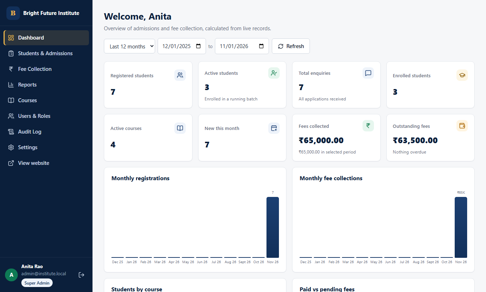
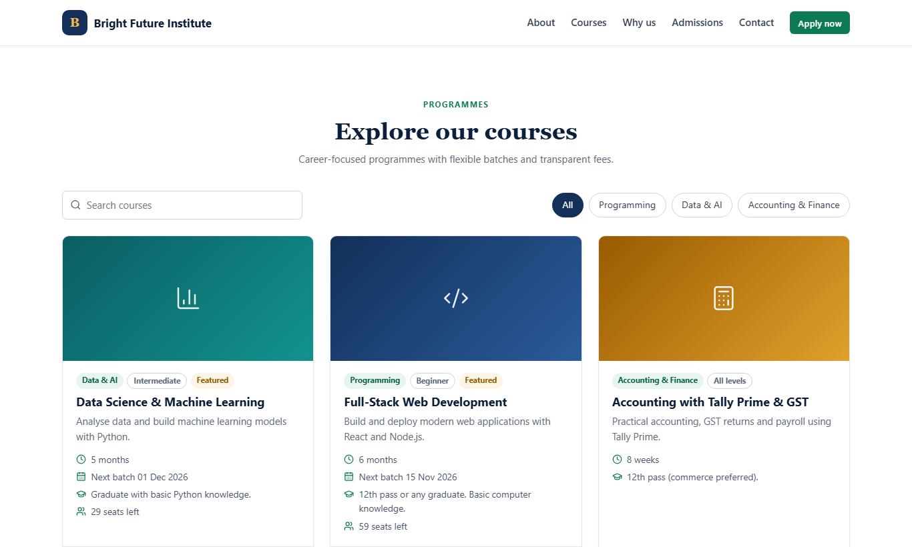
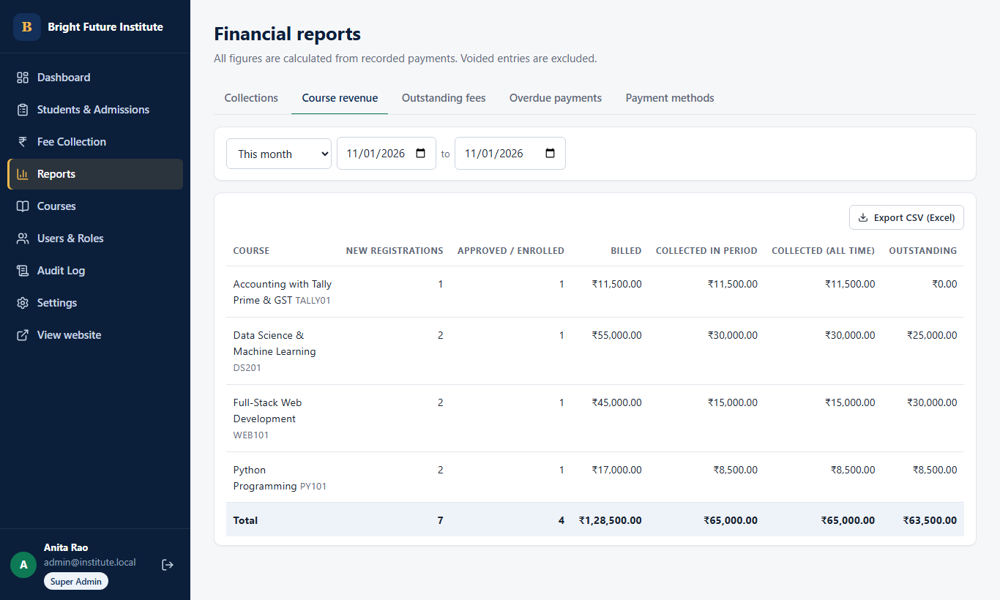
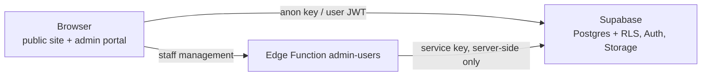

# Education Institute Management & Student Enrollment Portal

A web application for an education institute: a **public website** where students browse courses and apply online, and a **secure admin portal** where staff manage admissions, courses, fees, payments, receipts and reports.

**Problem it solves:** it replaces paper forms, spreadsheets and manual receipt books with one system. Fees and balances are calculated exactly, every payment has a numbered receipt and an audit trail, and each staff member sees only what their role allows.

| Public website | Admin dashboard |
|---|---|
|  |  |
|  |  |

## Key features
- **Public student portal** (`/`, no account needed)
  - Institute profile and contact details, managed from the admin portal.
  - Course catalogue with search, category filter, course details, fees and batches.
  - Admission form with validation and spam protection; the student gets a registration number on screen.
- **Admin portal** (`/admin`)
  - Dashboard with live statistics and charts.
  - Student & admission management: 8-stage pipeline, notes, CSV export.
  - Course, batch and category management, including images and versioned fees.
  - Per-student fees with discounts, scholarships and installments.
  - Payment collection with overpayment and duplicate protection; printable receipts; refunds and voids.
  - Financial reports with CSV export: daily, weekly, monthly and yearly collections, course revenue, outstanding, overdue, payment methods.
  - Staff accounts and roles, institute settings, audit log, password reset.
- **Responsive** on desktop, tablet and mobile.

## User roles
| Role | Can do |
|---|---|
| **Super Admin** | Everything, including staff accounts, roles, settings, refunds, voids and the audit log |
| **Administrator** | Courses, students, admissions, fee configuration, view payments and reports |
| **Accounts Staff** | View students, record payments, receipts, financial reports |
| **Admissions Staff** | Applications, admission status, student details and contact; no financial data |

Permissions are enforced **in the database** (PostgreSQL Row Level Security), not just in the UI. See [DEVELOPER_GUIDE.md §7](DEVELOPER_GUIDE.md#7-authentication-and-authorization).

## Technology stack
| Layer | Technology |
|---|---|
| Frontend | React 19, TypeScript, Vite 7, React Router 7, Lucide icons, custom CSS design system |
| Backend | Supabase: PostgreSQL 17 with RLS and SQL functions, Auth, Storage, one Edge Function. No custom server. |
| Testing | Vitest (unit + database integration), Playwright (desktop + mobile E2E) |
| Hosting | Static site on Cloudflare Pages (recommended) or Vercel, plus Supabase |



## Quick start (local)
**Prerequisites:** Node.js 20+, Docker Desktop (running), Git.

```bash
npm install
npm --prefix client install
npm run sb:start      # local Supabase in Docker (first run downloads images)
npm run sb:reset      # create schema + load sample data
npm run sb:env        # write client/.env.local (see client/.env.example)
```

Create a local Super Admin:
```bash
# macOS/Linux
SUPER_ADMIN_EMAIL=admin@institute.local SUPER_ADMIN_PASSWORD=Admin12345 node scripts/create-super-admin.mjs --local
# Windows PowerShell
$env:SUPER_ADMIN_EMAIL="admin@institute.local"; $env:SUPER_ADMIN_PASSWORD="Admin12345"; node scripts/create-super-admin.mjs --local
```

Start the app:
```bash
npm run dev           # http://localhost:5173  (admin: http://localhost:5173/admin)
```

**Environment variables.** The website needs only `VITE_SUPABASE_URL` and `VITE_SUPABASE_ANON_KEY`; see [client/.env.example](client/.env.example). Never put the Supabase service-role key in the client.

## Tests and production build
| Command | What it runs |
|---|---|
| `npm run test:unit` | Client unit tests |
| `npm run test:db` | Database, security and finance integration tests (needs local Supabase) |
| `npm test` | Both of the above |
| `npm run test:e2e` | Playwright browser tests; run `npx playwright install chromium` once first |
| `npm run build` | Type check + production build into `client/dist` |

## Documentation
- **[DEVELOPER_GUIDE.md](DEVELOPER_GUIDE.md):** architecture, code structure, database, security, workflows, how to extend.
- **[DEPLOYMENT_GUIDE.md](DEPLOYMENT_GUIDE.md):** step-by-step free-tier deployment, operations, backups, troubleshooting.
